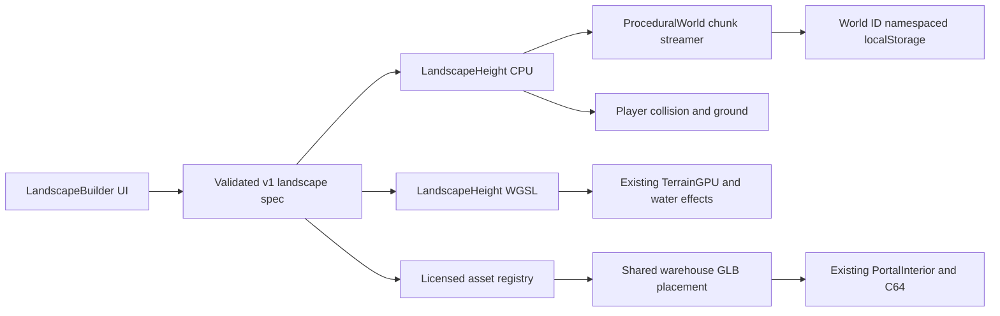

# Procedural world builder consolidation

Status: **experimental branch; qualification pending**. The default ElseMesh URL retains the authored island, warehouse, computers, roads and vehicles. The builder is opt-in at `?landscapeBuilder`; the existing `?procedural` test mode remains available. No production renderer was replaced.

## Architecture and audit

ElseMesh has its own WebGPU/WGSL renderer. `TerrainData` owns CPU height queries; `TerrainGPU` supplies the matching shader height to water, terrain lighting and post effects. `ProceduralWorld` already streamed 256 m chunks with three mesh LODs, 49 resident chunk slots, per-chunk instanced trees, a map and a separate localStorage save. The authored square `|x|,|z| <= 1536` includes the existing island systems and remains protected. `ThirdIslandSystem` owns the licensed Abandoned Warehouse and `PortalInterior` owns the functioning C64 and other computer room interactions. Earlier 2D-to-3D GLBs remain experimental gallery candidates; a photograph is not converted to reliable hidden geometry by this builder.

The previous procedural world and image-guided warehouse systems were reused instead of adding another engine. The landscape mode adds a versioned definition and a finite test domain centred at `(4096,4096)`, which is disjoint from authored content. It reuses the warehouse's loaded geometry and materials, with a second placement and collision layout. Its entrance leads to the existing computer room and returns to the correct exterior position. No proprietary model runtime or paid generation service is needed.

## Version 1 specification

The saved sample is [`public/landscapes/temperate-2049.json`](../public/landscapes/temperate-2049.json). Required identity fields are `version`, `seed`, `width`, `length`, `maxElevation`, `waterLevel`, `origin`, `description`, `features`, `terrainType`, `elevation.ruggedness`, `vegetation.treeDensity`, `vegetation.grassDensity`, `paths`, `roads`, `structures`, `references` and `qualityProfile`. Dimensions are metres. Width and length are 256–8192 m; seed is an unsigned 32-bit integer; elevation ceiling must exceed the water level and is at most 2000 m. The finite rectangle is exactly `origin ± width/2, length/2`; outside it the seabed is −90 m. The current global ElseMesh ocean is fixed at 0 m, so a nonzero `waterLevel` is rejected with an actionable message until regional water support exists.

The default sample is a 2000 × 2000 m temperate island with a 250 m elevation ceiling, coast, beach, hills, forest, mountain ridge, path, a licensed warehouse, seed 2049 and balanced quality. Its ID is derived from the canonical validated JSON and changes with every saved field. The ID isolates discovery, beacons and player position from the earlier procedural save. Ordinary game state continues to use ElseMesh's existing storage, so this is not a fully isolated world save.

Natural-language text is a bounded feature selector for **coast, beach, hills, forest and mountain ridge**. Unsupported requests such as caves or rivers produce warnings; prose does not secretly set dimensions, roads, structures or assets. Users can explicitly choose the supported features. References are approved asset metadata, not uploaded photos or geometry. The only placeable public adapter in this version is `abandoned-warehouse`; other GLBs require collision and entrance integration. See [landscape asset registry and rights](LANDSCAPE-ASSETS.md).

## User guide

1. Open `/?landscapeBuilder` on a local build. Enter a landscape description, dimensions, seed, terrain options, vegetation density, access and the warehouse choice. `Preview` draws the deterministic 2D height field and validates the form.
2. Use **Save and explore**. The validated JSON goes to localStorage key `elsemesh.landscape-spec.v1`; the URL gains `generated=1` and reloads the existing WebGPU renderer. Export JSON for a portable backup. An invalid or missing save leaves the authored world running and shows an error.
3. The scene opens near the generated warehouse. **Open landscape builder** exposes **Go home** and **Go to landscape** shortcuts for test travel. `N` opens the expanded map; `Y` places a persistent beacon on generated dry land. The existing movement, helicopter, warehouse interior and C64 controls apply.
4. Reload the same URL to reconstruct terrain from the saved seed and restore the namespaced exploration save. Import an exported JSON file to recreate a specification in another browser; it does not import ordinary game progress or private reference images.

The terrain generator uses deterministic bounded noise in both JavaScript and WGSL. Coastlines and beaches follow an analytic shelf and waterline; hills and a ridge use seeded relief. A graded corridor connects the default spawn to the actual warehouse gate. Path/road surfaces are distinct and are currently a single access route; winding networks and traffic are future work. Trees and low-cost grass tufts use per-chunk instancing, with LOD and disposal on unload. The renderer's existing culling still applies. Distant oceans and shader effects use the same height function as the player, within GPU float precision.

## Tests and measurements

Commands: `npm test`, `npm run test:landscape-gpu`, `npm run test:network`, `npm run test:security`, `npm run test:cargo`, `npm run test:vehicle-steering`, `npm run test:vehicle-material`, `npm run test:graphics`, `npm run test:renderer`, `npm run test:terrain-quality`, `npm run test:architecture`, `npm run test:publication`, `npm run build`. The pull request workflow runs this complete chain on GitHub's software Vulkan runner without deploying; `main` still triggers the established Pages deployment only after the build job passes.

The new tests cover schema validation, deterministic reconstruction, exact bounds/elevation cap, CPU/WGSL parity, coast and biome presence, rotated gate/path alignment, licence rejection, file hashes, warehouse floor/wall/door collision, adjacent chunk continuity, and namespaced beacon/player reload. GPU parity is measured on the available Dawn adapter, not a cross-vendor qualification. Browser navigation, visual quality and performance need actual scene evidence before merge.

| Measure | Baseline | Builder mode | Status |
| --- | --- | --- | --- |
| Authored scene FPS | Pending matched run | Pending matched run | Do not infer a gain from different camera views |
| Test island FPS and 1% low | No baseline: new scene | Pending | Compare repeated runs of the same saved spec |
| GPU frame/pass cost | Pending | Pending | Only if timestamp queries are reliable |
| GPU memory | Unavailable | Unavailable | Terrain buffer bytes are an estimate, not total VRAM |
| Generated chunk count | N/A | Up to 49 resident | Configured cap, not a measured FPS result |

## Known issues and release gate

- The builder is a structured procedural system, not general image-to-mesh AI. Neither Argon nor any other paid API is invoked. Hidden building geometry remains inferred in older experimental candidates.
- The global ocean has one sea level; version 1 accepts only 0 m. Generated shores do not yet reproduce all authored near-shore wave and foam art direction.
- The placed warehouse shares the existing portal computer room; it is not a separately modelled interior at the generated coordinates.
- The only generated path/road is one warehouse access corridor. No arbitrary user structure placement, terrain deformation, persistent building edits, infinite world expansion, floating origin or mobile/device qualification is claimed.
- Browser localStorage can fail or be cleared. Beacon and player state are namespaced by spec ID, but normal ElseMesh gameplay state may still be shared.
- Asset registry records repository provenance and file hashes; it is not a fresh upstream rights review. The 40 MB warehouse GLB is reused in memory and remains expensive to download on first load.
- Do not merge or deploy until the browser journey, screenshot/performance evidence, full CI chain and human visual review are complete. A PR build alone is not a production qualification.

## Deployment and rollback

The existing `.github/workflows/deploy.yml` deploys GitHub Pages after a successful `main` build. The feature branch and PR are review surfaces; they do not deploy. If later approved and merged, verify the live default URL and `?landscapeBuilder`/`generated=1` in a browser, including console, navigation, C64 and matched performance. Retain the previous `main` SHA. Rollback by reverting the merge on `main` and letting the same Pages workflow redeploy; loading the URL without `landscapeBuilder` also restores the authored rendering path immediately. Do not delete localStorage to roll back code; exported JSON preserves the landscape spec.

## Governance gates

**Plan gate:** Triggered by renderer, terrain, asset, persistence and deployment integration. The architect challenged origin safety, immutable validation, CPU/WGSL parity, actual entrance/road alignment, explicit rights, save namespace and matched benchmarks. The primary chose an opt-in finite domain outside the protected authored square, a shared terrain definition, existing chunk streamer and shared warehouse geometry. The architect warned that the initial 2 km prototype is not an effectively endless world or release-ready integration.

**Completion gate:** Pending independent review of browser results, regression suite, documentation, resource cleanup, security and unmet acceptance criteria.
