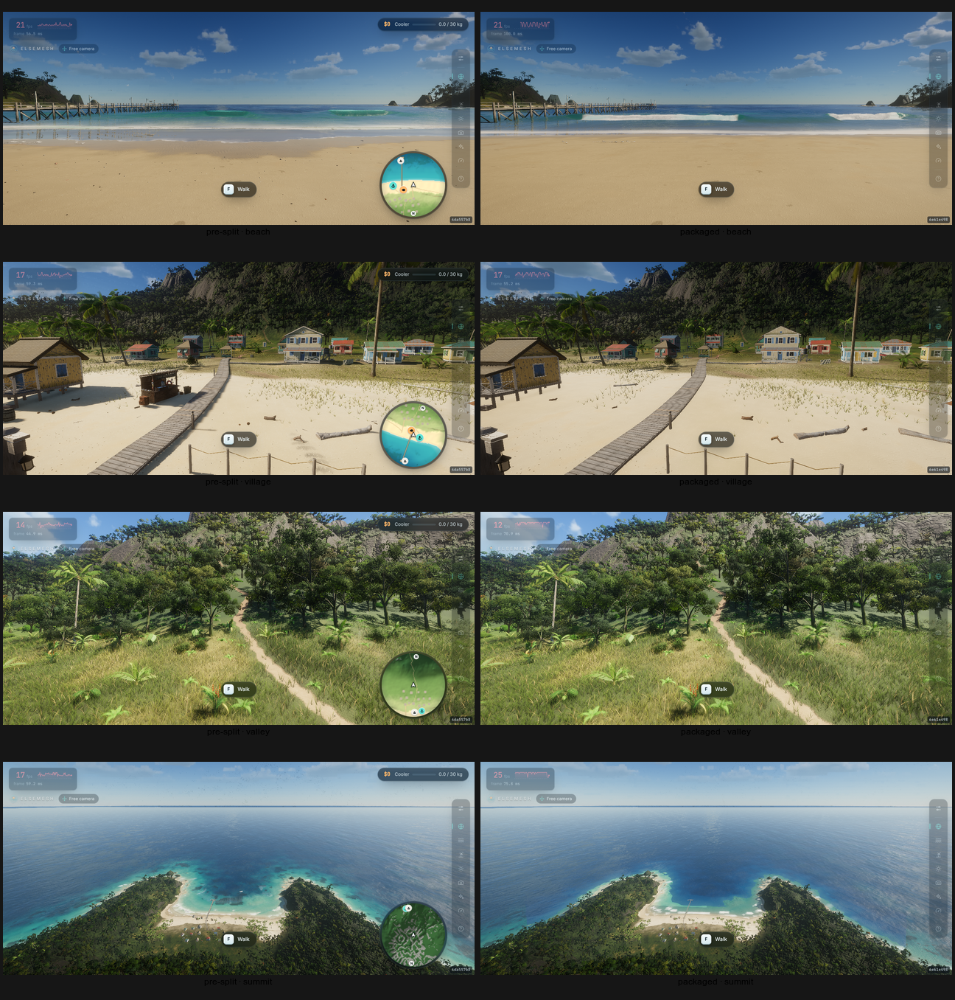
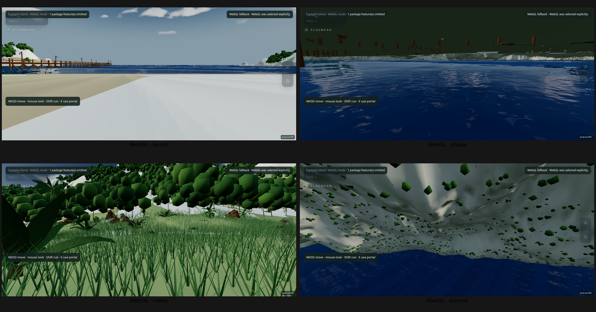

# Reproducible graphics review

## Tidewater split runtime parity follow-up, 2026-10-28

The live signed Tidewater package was checked in an isolated Chromium session.
The WebGPU run used the Radeon Vulkan adapter. It connected to
`elsemesh:example-island`,
activated the fishing behavior and hosted boat, and showed the fish stand and
Joe's vendor as active. During a 6.4-second idle sample, the moored boat moved
2.9 cm from its starting position; peak roll was 5.1° and pitch 1.7°.

The same hosted manifest was then loaded with the WebGL fallback. All 38
declared world components were supported, with none omitted. The packaged fish
stand geometry and Joe's vendor loaded; invoking the in-range interaction
opened Joe's buyer panel. In a 4-second idle sample the boat remained moored
and upright (peak roll 9.6°, pitch 5.3°). Focused checks passed for WebGL boat
stability, fish-stand placement and colliders, vendor/gameplay behavior, and
the signed Tidewater extension runtime.

This verifies the fish stand and idle-boat gameplay paths in both renderers;
it does not close visual parity. The matched WebGPU comparison below still
records small water, foam, shoreline, debris, and minimap differences. The
current WebGL live capture also shows renderer-specific water and ground
artifacts, so WebGL is accepted here for shared content and gameplay only, not
as a visual match to the pre-split WebGPU renderer.

## Tidewater post-split parity review, 2026-10-27

Compared the pre-split ElseMesh tree at `23c30bf62aae2aefd0f2bcdd3edc650cf960ce3e`
with the packaged `worlds/tidewater` content pinned at
`cbcac318a28ccc0acfc71ee5a0ffa4f95db7b02a`. WebGPU views use a 1280×577 viewport, render scale 1, shadows, TAA, fixed-time
named camera poses, and an isolated headless Weston display with the Radeon
Vulkan adapter. The user's desktop browser and display were not used. The
contact sheet pairs pre-split on the left with packaged Tidewater on the right;
rows run beach, village, valley, and summit.

### WebGPU matched comparison

All four views retain the same broad island composition, terrain, vegetation,
village buildings, boardwalk, beach, pier, and summit inlet. Village and valley
content are especially close. Remaining world-rendering deltas are the water
surface and shallow-water/foam patterns, plus small shoreline and debris
details; they are most noticeable at the beach and summit. The packaged capture
also lacks the pre-split minimap overlay, which is an engine UI difference, not
a Tidewater asset difference. These views support close scene parity at the
checked poses, not pixel identity or parity at every camera position.

The packaged WebGPU page reported `remoteWorldActive: true` with one active
world. The first live check exposed missing `worldId` fields in direct WebRTC
requests; the client now includes the world ID. The response path now sends JSON
text and the client also decodes binary `ArrayBuffer`/`Blob` frames. The live
isolated browser then loaded the packaged manifest over WebRTC and captured all
four views.

### WebGL separate review

WebGL was reviewed separately at the same four named camera poses; it was not
compared with the pre-split WebGL renderer as a parity baseline. The isolated
page selected WebGL and reported one omitted package feature. It used Chromium
ANGLE/OpenGL on the Radeon Graphics adapter (Mesa 26.1.6), with Vulkan disabled,
at a 1280×577 viewport and the same four named camera poses. The fallback shows
pale, flat beach ground and dark water; the village view is under the pier; the
valley has oversized vegetation; and the summit view sees the terrain
underside. The omitted package feature is
`elsemesh.village-materials/2` (`elsemesh-component:island-village-materials`).
This is a current-state review, not parity acceptance. WebGL parity remains
unaccepted pending fixes to terrain placement, water, vegetation, shoreline
presentation, and village materials.

The pinned submodule check verified 60 Tidewater assets. `npm run build`, the
full `npm test` suite, and `go test ./worldd` pass from the external build tree
with the shared Go cache configured. The multi-world profile fixture is not part of this renderer review.

The current ElseMesh build accepts review-camera URL parameters so a view can be opened in a local build or the fork deployment:

- `?view=beach` opens the beach and pier overview.
- `?view=village` opens the beach buildings.
- `?view=tValley` opens the mountain valley and trail approach.
- `?view=tSummit` opens the summit.
- `?pose=<URL-encoded-JSON>` restores a captured pose with `p` (three coordinates), `yaw`, `pitch`, and optional `time`. The shape matches the JSON returned by the existing `window.__pose()` review helper.

These opt-in parameters switch to the existing free camera; they do not affect ordinary launches. Named poses also set a fixed time of day, so lighting is consistent across captures.

The upstream `dgreenheck.github.io/tidewater/` deployment does not include these review-camera parameters. A URL such as `?view=beach` there is ignored, so its spawn view cannot be treated as the same pose as one of the named ElseMesh views. Before calling an image comparison like-for-like, arrange for both builds to use the same camera pose, viewport, time of day, render scale, anti-aliasing, shadows, and water-reflection settings. Otherwise report the mismatch and use screenshots only to identify candidate differences.

## Flip7 native Chrome WebGL smoke check, 2026-10-24

The local client ran in Android Chrome on a scrcpy virtual display at
720×1600, density 280, logical display 7, mapped to SurfaceFlinger display ID
`11529215046550001813`. The activity and captures were confined to that
virtual display; neither physical panel was targeted. WebGL mode loaded the
island scene and packaged Whale. A Chrome DevTools camera follow showed the
Whale render underwater, and a forced call to its existing blow effect emitted
visible particles through the new WebGL spray batch. The forced emission checks
the presentation adapter; it does not prove the natural blow timing or particle
physics match the WebGPU spray simulation.

This run exposed and fixed three startup faults in the fallback path: Vite
treated fetched extensionless package assets as JavaScript, the vegetation
loader tried to append scalar `villagePalms` metadata as an array, and the
WebGL water query lacked the `get(slot)` method used by the shared Whale brain.
The Vite raw-byte and URL-module routes, placement append helper, and spray
batch have focused regression tests; the full `npm test` suite and production
build pass.

This is a renderer smoke check, not a matched comparison. It used the built-in
island rather than a hosted package, did not compare against WebGPU at the same
pose, and did not establish lighting, shadow, spray-physics, LOD, density, or
performance parity. The screenshot includes the review UI and is only useful
for confirming that the Whale and emitted particles appeared.

## Flip7 hosted grass-density review, 2026-10-23

The current source was served locally from a temporary, loopback-only Example
Island profile. Its signed manifest included the content-addressed
`grass-density/1` mask. Chrome ran on Rebroad scrcpy commit `b59a3d82`'s
persistent display-only virtual display at 720×1600, density 320, CSS viewport
360×696, DPR 2, and render scale 1. Chrome's activity was verified on logical
display 24; captures used only SurfaceFlinger display ID
`11529215048938202412`. The app showed source stamp `a0034d9a`.

Hosted and built-in renders used pose `[62, 7, -62]`, yaw `0.34`, pitch
`-0.12`, and 15:30. Grass is visible on the beach in both frames, so the
hosted package no longer has the complete grass omission seen in the earlier
2026-10-23 comparison. This confirms rendered grass presence with the packaged
mask; it does not establish matching density at every location, LOD behavior,
other views, or sustained performance. The hosted HUD read about 20 FPS and the
built-in HUD about 18 FPS during these captures; these are individual readings,
not performance acceptance results. See the [hosted frame](images/flip7-hosted-grass-village-2026-10-23.png)
and [built-in frame](images/flip7-built-in-grass-village-2026-10-23.png).

## Flip7 hosted-package renderer fix and matched start view, 2026-10-22

The local hosted Example Island initially stayed black. Runtime logs identified
two failures: the hosted static-fish-props component had no `update()` method,
and the terrain shader combined the hosted heightfield with lighting hooks bound
to the built-in heightfield. The update loop now skips optional component update
methods, and hosted terrain activates underwater and ground-bounce hooks bound
to its own terrain GPU module. `TerrainGPU` also binds its configured detail
texture, so packaged and built-in terrain modules agree on that resource.

On the Flip7, Chrome ran only on scrcpy virtual displays at 720×1600, density
420, CSS viewport 274×505, and render scale 1. The hosted world and built-in
world were captured at position [53.6, 4.53, -77], yaw 3.14, pitch -0.05, and
16:12. The hosted app became active and its render-frame counter advanced past
1,700 without the terrain-binding error. Its HUD ranged from 25 to 34 FPS in
the matched capture; readings varied between captures, so this is not a
performance acceptance result. The authored pier, beach, and ocean appear
broadly similar in the two frames. Small material, shadow, and gameplay
differences still need review. See the [hosted frame](images/flip7-hosted-example-2026-10-22.png)
and [built-in frame](images/flip7-built-in-example-2026-10-22.png).

This verifies the hosted Android start view and a matched-pose Android visual
review. Desktop comparison, other island views, gameplay parity, and sustained
performance acceptance remain open. Chrome's player-presence warning about a
closed direct WebRTC channel also remains; the world render itself continued.

## Follow-up browser check, 2026-10-01

The desktop Chrome tab for `https://rebroad.github.io/tidewater/?view=beach` showed a white 3D view while its ElseMesh HUD and performance panel remained active (10 fps, 466 × 295 render size, 50% scale, shadows and water reflections off). The upstream tab completed startup and rendered the beach scene. The two captures used different viewports and the upstream ignored `?view=beach`, so they are not a like-for-like graphics comparison. This differs from the earlier same-day check, which observed both pages rendering. Root cause of the white current view is unknown; inspect fresh renderer diagnostics before attributing it to the world package or making visual changes. The Flip7 had no ADB device, and SSH to its configured `192.168.192.7:8022` endpoint returned `Network is unreachable`.

Record the browser viewport and Performance-tab render scale with each capture: Linux adaptive rendering can lower internal resolution when it misses its 24 FPS target, while the Android path retains its full-quality settings.

## Browser check, 2026-10-01

The Flip7 was not reachable over ADB or SSH during this check, so Chrome on the desktop was used to inspect both deployed pages. Both started and rendered. The upstream page reported 1166 × 683 render size, 100% scale, shadows on, and water reflections on. The fork page at `?view=beach` reported 466 × 295, 50% scale, shadows off, and water reflections off; its URL-selected view worked. The browser tabs had different viewport sizes, and the upstream ignored the named-view URL, so these captures do not establish visual parity. They do confirm that Linux adaptive defaults visibly change rendering settings; those settings are Linux-only in `src/App.js`, with Android excluded by platform detection. A matched camera and viewport comparison remains required before deciding whether scene content or materials regressed.

## Mountain color parity

The island exporter currently writes its 513 × 513 heightfield as a static GLB with hand-authored `COLOR_0` values. That export choice approximates terrain zones; it is not a limit of export or of GLB. Those vertex colors cannot carry the original shader’s layered detail textures, slope-dependent rock, wetness, triplanar rock, or terrain lighting, so drawing that mesh as the final visual surface made the mountain look flatter and differently colored than upstream.

The signed `elsemesh.terrain-surface/1` component now carries the deterministic heightfield, baked normal/rock/AO and terrain masks, detail texture, palette, and material parameters. The terrain GLB stays for collision and fallback. The exporter test checks deterministic bytes and the versioned original-terrain material profile. Matched-view screenshots against upstream and Flip7 visual confirmation remain outstanding; see [the terrain export fidelity contract](../worlds/tidewater/docs/schemas/terrain-package.md).

## Village texture package

The Example Island package now includes the GPU-baked village PBR maps in its own content-addressed `elsemesh.village-materials/2` asset. This removes the prior omission of baked wood, roof, thatch, stone, metal, grime, rope, and net texture inputs. The client regenerates only mip levels from the packaged level-zero bytes and uses the trusted original village shader profile. A matched-camera review of the packaged village against upstream and the Flip7 is still required before claiming visual parity; see [the village material asset contract](../worlds/tidewater/docs/schemas/village-materials.md).

## WebGL fallback check, 2026-10-10

The hosted page initially reported `WebGL fallback failed (Cannot read properties of undefined (reading 'WebGLRenderer'))` after WebGPU adapter creation failed. `three@0.180` exposes `WebGLRenderer` as a named ESM export, not a default export. Commit `58f253c` changed the lazy import to use the module namespace and added a regression check. The Pages workflow succeeded, and the live page showed build stamp `58f253c8`; its fallback error changed to `WebGL fallback failed (Error creating WebGL context.)`. That confirms the module import defect is fixed and the renderer constructor was reached. This Chrome session has neither a usable WebGPU adapter nor a usable WebGL context, so it still cannot verify scene rendering. No game click or pointer-lock request was used. The separate `npm run test:webgl-backend` check and production build pass.

## WebGL whale shadow follow-up, 2026-10-24

The WebGL whale now has a custom depth material that applies the packaged
height relief and the same animated rig pose used by its visible material.
The focused package test verifies shader injection and that each LOD uses that
depth material. A live compile could not be completed here: Termux Chromium's
headless SwiftShader GPU process exited with code 11, reported
`BindToCurrentSequence failed`, and returned no WebGL context. This does not
verify the rendered shadow or establish whale visual parity.

## WebGL fallback scene and asset path, 2026-10-11

Commit `40554cf` expanded the fallback scene with terrain colors derived from
the packaged terrain masks and height data, multi-scale terrain detail,
camera-following grass, and packaged vegetation placements. The full client
test suite and Vite production build pass from the external build tree, and
`npm run test:webgl-backend` passes. These checks establish that the fallback
code bundles and backend selection works; they do not show how the scene looks
or performs on an actual WebGL context. Matched-view browser verification is
still outstanding, and the earlier browser session had no usable WebGL
context. The optional Blender worker runtime test was also attempted but
could not enter its Bubblewrap namespace in this container; it remains
unverified here.

## Flip7 virtual-display smoke check, 2026-10-10

The deployed `https://elsemesh.github.io/` page was opened in Chrome on the
scrcpy virtual display only (logical display 29, 720×1600; SurfaceFlinger ID
`11529215050196523144`). The start page advanced into the playable island after
a tap explicitly sent to display 29. The resulting view showed the pier, beach,
ocean, HUD, touch controls, and commit badge `e9399014`; the HUD reported
29 FPS. No white-texture failure appeared in that view. This verifies a
single start-area renderer smoke check on the phone. It does not verify the
mountain, trail, village, seabed, boat, LOD transitions, or visual parity.

The original `https://dgreenheck.github.io/tidewater/` page was opened on the
same virtual display and viewport. It initially showed shader compilation at
38%; after loading, it reached its playable pier start view. The two views
show broadly similar pier, beach, and ocean materials, with no white-texture
failure in the ElseMesh view. The current HUD read 29 FPS and the original read
23 FPS at capture time. This is an approximate start-view comparison only:
camera pose, time, exposure, and render settings were not captured precisely
enough to call it a controlled match or sign off on visual parity. The retained
captures show the [current playable scene](images/flip7-virtual-current-2026-10-10.png)
and the [original playable scene](images/flip7-virtual-baseline-playable-2026-10-10.png).
Neither physical Flip7 display was targeted.

## Direct unlisted gateway on Flip7, 2026-10-11

The current hosted client was opened with a direct Example Island invite through
an unlisted Cloudflare Quick Tunnel to the local `thruholdd` gateway. The public
`/healthz` endpoint returned HTTP 200. No gateway was published to the Worker
directory or DHT; the random Quick Tunnel URL was shared directly for this
test and was not added to project documentation or discovery. The tunnel is
temporary, has no uptime guarantee, and anyone who obtains its URL can reach
the gateway and served content.

Chrome ran only on scrcpy virtual display 30 (720×1600; SurfaceFlinger ID
`11529215048683042661`). The initial invite reached the hosted loading page,
then the playable pier view. The on-screen stamp `8340dfcd` matched the
`main` HEAD at capture time, and the HUD reported about 54 FPS. The pier wood,
beach, and water rendered without the earlier white-texture failure. The
captured view is available at
[the Flip7 direct-gateway screenshot](images/flip7-unlisted-direct-gateway-2026-10-11.png).

This verifies one public HTTPS/WSS gateway path and the start area on one
device. It does not establish an independent-network/NAT test, relay or WebRTC
fallback, portal traversal, matched visual parity against the original, or
persistent gateway availability. A desktop Chrome attempt remains unable to
create either a WebGPU adapter or WebGL context, so it could not render the
scene. During the first phone launch attempt, shell handling split the invite
URL at its `&` separators; quoting the complete remote `am start` command fixed
the test invocation. No source change was needed for that issue.
